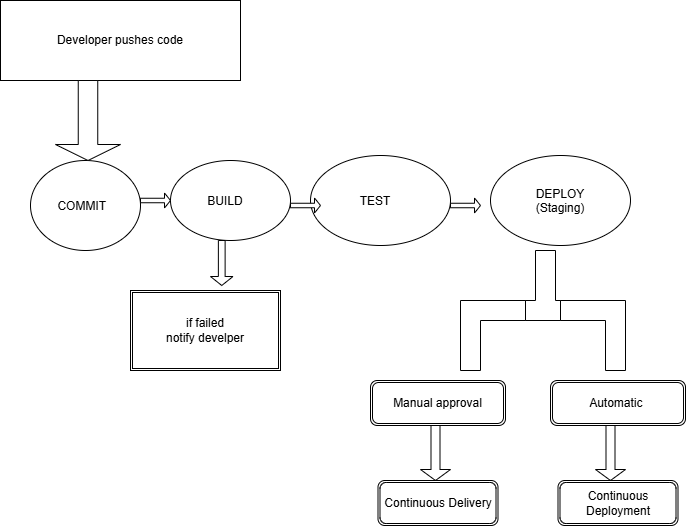

# Week 5 Day 21 - What is CI/CD?

## Continuous Integration (CI)

Small pieces of code are frequently merged into the repo. This will automatically build and test the code, so any issues can be picked up early.

## Continuous Delivery

Once the tests have passed, the code will automatically be packaged and deployed into staging. The code can be released at any time, however it must be approved by someone.

## Continuous Deployment

This is the same as Continuous Delivery, however there is no manual approval. If all the tests pass then the code will automatically be deployed into production.

The key difference between delivery and deployment is that delivery requires manual approval whereas deployment is fully automated.
